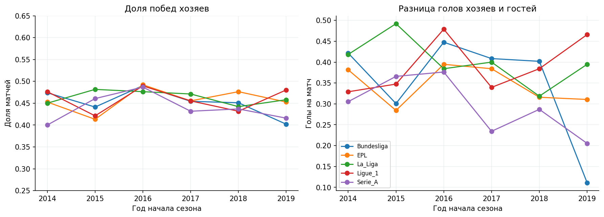
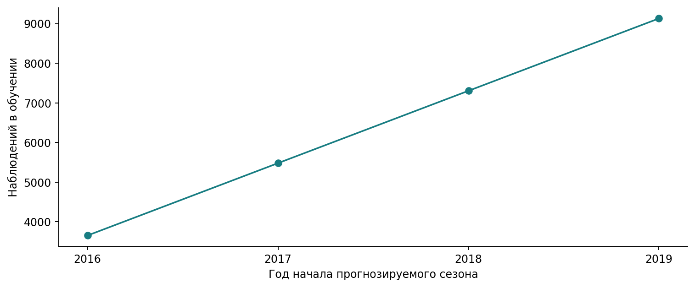
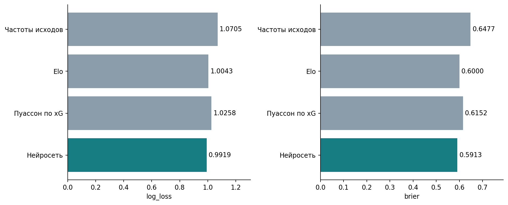
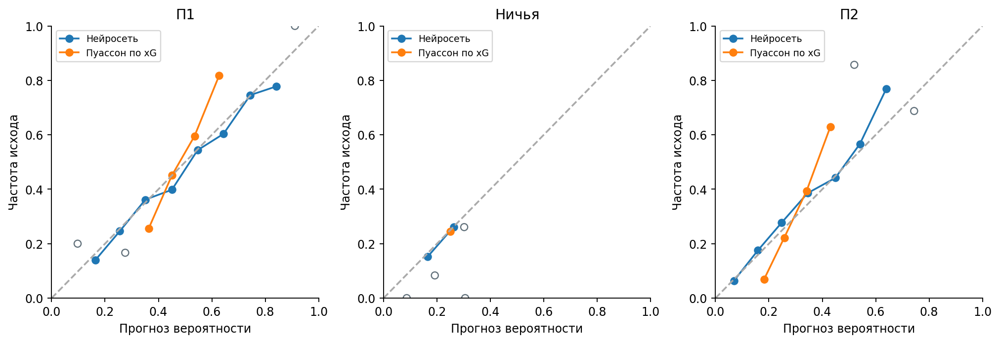
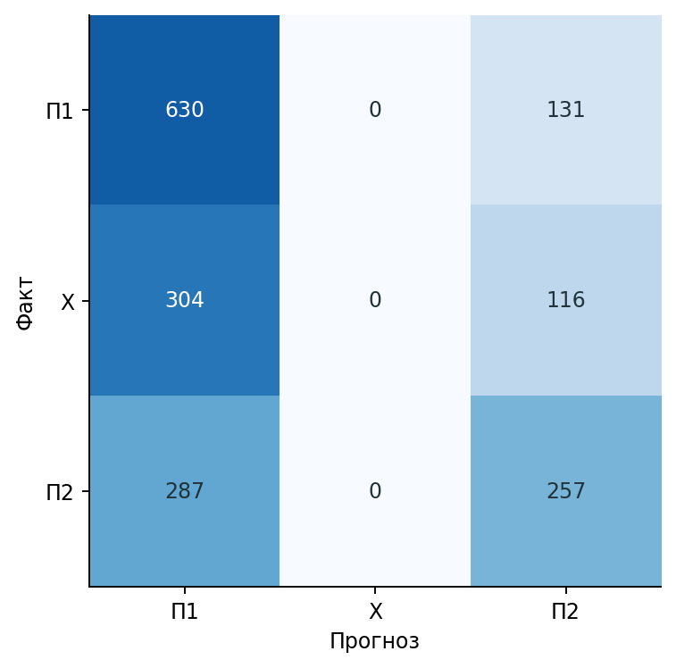
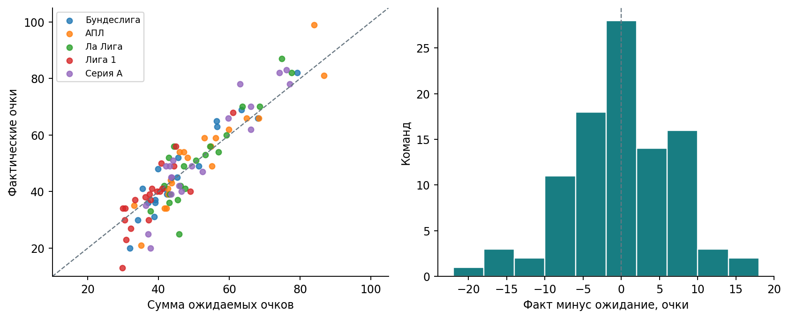

# Вероятности исходов футбольных матчей

Нейросеть TensorFlow/Keras прогнозирует победу хозяев, ничью и победу гостей до начала матча. Используется архив Understat по пяти лигам за 2014/15–2019/20. Модель ежегодно обучается заново на всей завершённой истории.

<!-- CONTENTS:START -->
## Содержание

- [Задача и время прогноза](#section-1)
- [Источник и подготовка данных](#section-2)
- [Лиги и домашнее преимущество](#section-3)
- [Признаки до начала матча](#section-4)
- [Нейросеть и расширяющееся окно](#section-5)
- [Простые ориентиры](#section-6)
- [Качество прогноза](#section-7)
- [Вероятности и ошибки исходов](#section-8)
- [Неопределённость результата](#section-9)
- [Перерыв в сезоне 2019/20](#section-10)
- [Прогнозы матчей и ожидаемые очки](#section-11)
- [Насколько точно получаются очки команд](#section-12)
- [Насколько точно получаются места](#section-13)
- [Сравнение по очкам и местам](#section-14)
- [Турнирные таблицы сезона 2019/20](#section-15)
- [Выводы](#section-16)
- [Словарь данных](#section-17)
- [Источники](#section-18)
- [Воспроизведение](#section-19)
<!-- CONTENTS:END -->

<a id="section-1"></a>

## Задача и время прогноза

Для каждой встречи нужны три вероятности, сумма которых равна единице. Они позволяют учитывать неопределённость исхода и рассчитывать ожидаемые очки команд. Прогноз строится на начало календарного дня. Результаты встреч этого дня добавляются в историю со следующей даты.

Единица наблюдения — сыгранный матч. Целевая переменная равна 0 при победе хозяев, 1 при ничьей и 2 при победе гостей. Все матчи одного дня используют одинаковую границу доступной информации.

<a id="section-2"></a>

## Источник и подготовка данных

Первичный поставщик — Understat; таблицы получены из закреплённой версии публичного зеркала Mark Wilkins. В анализ входят 10,855 сыгранных матчей АПЛ, Ла Лиги, Бундеслиги, Серии А и Лиги 1. Период простирается с 2014-08-08 по 2020-08-02.

Исключена 101 строка без сыгранного результата, преимущественно отменённые встречи Лиги 1. Проверяются уникальность ID, конечные неотрицательные голы и xG, даты и состав лиг. В архиве 465 матчей хотя бы с одной командой, имеющей менее пяти предыдущих игр в доступной истории.

Текущие голы и xG используются после завершения матча. Готовые `forecast.w/d/l` поставщика исключены из входов, поскольку их доступность до игры не подтверждена. Даты читаются в календарной шкале источника. Архив является поздним снимком; историю исправлений xG и дат по нему восстановить нельзя.

<a id="section-3"></a>

## Лиги и домашнее преимущество



Сравниваются доля домашних побед и разница голов хозяев и гостей на матч. Показатели рассчитываются отдельно для лиги и сезона. Такое представление учитывает разные размеры чемпионатов. Сезон Лиги 1 2019/20 завершён досрочно; для него учитываются сыгранные встречи.

Графики описывают результативность дома и в гостях. На межсезонные различия влияют состав клубов, календарь и условия проведения матчей. Все агрегаты доступны в [таблице лиг и сезонов](tables/league_seasons.csv).

<a id="section-4"></a>

## Признаки до начала матча

Для хозяев и гостей используются средние голов, xG за и против и очков за последние 5 и 10 встреч. Дополняют их число дней отдыха, число матчей за 14 дней, домашняя и гостевая история и рейтинг Elo. Число предыдущих встреч ограничено 100, отдых — 60 днями. Отдельно сохраняется доступность истории.

История привязана к лиге и ID клуба. Названия и идентификаторы служат соединению записей; лига входит в сеть как категория. В матрице нет будущих итогов сезона и результата прогнозируемой игры. Тесты изменяют текущие и будущие результаты и проверяют неизменность более ранних признаков.

Пустая история заполняется медианами обучения и получает индикатор пропуска. Масштабы числовых признаков и категории лиг определяются заново внутри каждого обучающего окна. Для нового клуба Elo начинается с 1500.

<a id="section-5"></a>

## Нейросеть и расширяющееся окно

Итоговая модель усредняет вероятности двух сетей с одинаковыми скрытыми слоями 32/16 и разными seed — 20261104 и 20261121. Используются ReLU, L2=0.005 и Dropout=0.2. Три выходных логита преобразуются softmax в П1/Х/П2. Adam работает с learning rate 0.001, размер пакета 256, функция потерь — cross-entropy.

Перед началом сезона последний завершённый сезон временно выделяется для ранней остановки. На более ранних сезонах оцениваются преобразования и веса; остановка отслеживает log loss, максимум 100 эпох, patience=10. Затем сеть и преобразования обучаются с нуля на всей доступной истории с выбранным числом эпох. Две сети получают собственное число эпох.



| Период | Обучение | Прогноз | Эпохи двух сетей |
| --- | --- | --- | --- |
| 2016 | 3652 | 1826 | 26 / 25 |
| 2017 | 5478 | 1826 | 51 / 26 |
| 2018 | 7304 | 1826 | 23 / 46 |
| 2019 | 9130 | 1725 | 28 / 12 |

Проверочные сезоны 2017/18 и 2018/19 используют только более ранние результаты. Для оценки 2019/20 сеть обучена на 9 130 матчах сезонов 2014/15–2018/19. Во время прогнозируемого сезона веса фиксированы, а входная история команд пополняется после завершённых дней. Вероятности берутся из среднего softmax двух сетей.

<a id="section-6"></a>

## Простые ориентиры

Постоянный прогноз использует частоты П1/Х/П2. Elo обновляется после игрового дня с K=20 и домашней поправкой 70. На границе сезона сохраняется 75% отклонения рейтинга от 1500. Частоты исходов и параметр ничьей Elo оценены на сезонах 2014/15–2016/17; сам рейтинг продолжает обновляться по завершённым матчам.

Пуассоновский ориентир берёт геометрическое среднее прошлого xG атаки команды и xG обороны соперника с учётом дома/выезда. Командные средние сглаживаются пятью условными матчами к прошлому среднему лиги. Начальная лига содержит 20 условных матчей с 1.4 домашнего и 1.1 гостевого xG. Интенсивности ограничены диапазоном [0.1; 6], счёт перебирается от 0 до 30 голов, затем вероятности нормируются. Голы команд в этом ориентире предполагаются независимыми.

<a id="section-7"></a>

## Качество прогноза

Основная метрика — log loss. Brier равен средней сумме квадратов ошибок трёх вероятностей. Accuracy — доля матчей, в которых наиболее вероятный исход совпал с фактом. Все модели оцениваются на одинаковых 1,725 матчах.

| Модель | Матчи | Log loss | Brier | Accuracy |
| --- | --- | --- | --- | --- |
| Частоты исходов | 1725 | 1.07046 | 0.64767 | 0.44116 |
| Elo | 1725 | 1.00428 | 0.60004 | 0.51710 |
| Пуассон по xG | 1725 | 1.02579 | 0.61521 | 0.48986 |
| Нейросеть | 1725 | 0.99187 | 0.59131 | 0.51420 |



| Лига | Матчи | Log loss | Brier | Accuracy |
| --- | --- | --- | --- | --- |
| Бундеслига | 306 | 0.99556 | 0.59439 | 0.50654 |
| АПЛ | 380 | 0.97839 | 0.58139 | 0.51053 |
| Ла Лига | 380 | 1.00876 | 0.60541 | 0.49737 |
| Лига 1 | 279 | 1.00092 | 0.59925 | 0.50538 |
| Серия А | 380 | 0.97882 | 0.57882 | 0.54737 |

Разрезы показывают качество отдельно по каждой лиге. При сравнении важны число матчей, баланс исходов и полнота истории новых команд.

<a id="section-8"></a>

## Вероятности и ошибки исходов



Для каждого исхода прогнозы разбиты на интервалы шириной 0.1. Средняя вероятность сопоставлена с долей фактических исходов. Полые точки обозначают интервалы с менее чем 30 матчами. Это проверка вероятностей итоговой сети.



Ничья оказалась наиболее вероятным исходом в 0 матчах из 1725. Матрица отражает решение по максимуму вероятности; log loss использует весь вектор и чувствителен к уверенности прогноза.

<a id="section-9"></a>

## Неопределённость результата

| Ориентир | Разница log loss | Нижняя 95% | Верхняя 95% |
| --- | --- | --- | --- |
| Частоты исходов | -0.07859 | -0.09533 | -0.06216 |
| Elo | -0.01241 | -0.02066 | -0.00375 |
| Пуассон по xG | -0.03392 | -0.04459 | -0.02368 |

Разница равна log loss нейросети минус log loss ориентира. 95% интервалы рассчитаны 3 000 повторами парного бутстрэпа по календарным неделям. Все встречи одной недели остаются в одном блоке. Связи повторных игр клубов между неделями могут сохраняться; поправка на несколько сравнений не вводилась.

<a id="section-10"></a>

## Перерыв в сезоне 2019/20

| Модель | Период | Матчи | Log loss | Brier |
| --- | --- | --- | --- | --- |
| Elo | До перерыва | 1317 | 1.00945 | 0.60380 |
| Elo | После перерыва | 408 | 0.98757 | 0.58791 |
| Пуассон по xG | До перерыва | 1317 | 1.02911 | 0.61767 |
| Пуассон по xG | После перерыва | 408 | 1.01508 | 0.60725 |
| Нейросеть | До перерыва | 1317 | 1.00026 | 0.59746 |
| Нейросеть | После перерыва | 408 | 0.96477 | 0.57146 |

Первая группа включает даты до 15 марта 2020 года, вторая — с 15 мая. Лига 1 сезон не возобновила, поэтому состав лиг во второй группе отличается. Разрез показывает устойчивость ошибок в двух частях календаря; для объяснения различий потребовались бы посещаемость, составы и травмы.

<a id="section-11"></a>

## Прогнозы матчей и ожидаемые очки

| Дата | Хозяева | Гости | П1 | Ничья | П2 |
| --- | --- | --- | --- | --- | --- |
| 2020-08-01 | AC Milan | Cagliari | 0.753 | 0.168 | 0.079 |
| 2020-08-01 | Brescia | Sampdoria | 0.361 | 0.284 | 0.355 |
| 2020-08-01 | Juventus | Roma | 0.622 | 0.230 | 0.148 |
| 2020-08-02 | SPAL 2013 | Fiorentina | 0.319 | 0.273 | 0.408 |
| 2020-08-02 | Sassuolo | Udinese | 0.483 | 0.281 | 0.236 |
| 2020-08-02 | Bologna | Torino | 0.455 | 0.291 | 0.254 |
| 2020-08-02 | Genoa | Verona | 0.410 | 0.292 | 0.298 |
| 2020-08-02 | Lecce | Parma Calcio 1913 | 0.488 | 0.269 | 0.243 |

Показаны исторические прогнозы последних матчей архива. Например, вероятность 0.6 означает оценку 60% для соответствующего исхода при доступной модели информации. Для каждой команды ожидаемые очки в матче равны 3 × P(победа) + P(ничья).

<a id="section-12"></a>

## Насколько точно получаются очки команд

Для каждой команды складываются ожидаемые очки всех сыгранных матчей сезона 2019/20. Каждый прогноз использует историю, доступную перед конкретной встречей. Таким образом оценивается сумма последовательных предматчевых прогнозов с обновлением формы команды по ходу сезона. Для прогноза всей таблицы на старте сезона потребуется отдельная проверка с информацией, доступной на эту дату.

Ошибка равна фактическим очкам минус расчётным. Плюс означает, что команда набрала больше ожидаемого, минус — меньше. Средняя абсолютная ошибка показывает обычный размер расхождения без взаимного погашения плюсов и минусов.

| Лига | Команд | Средняя ошибка | Смещение | Ст. отклонение | Дисперсия |
| --- | --- | --- | --- | --- | --- |
| Все команды | 98 | 5.18 | 0.07 | 6.71 | 45.06 |
| Бундеслига | 18 | 4.56 | 0.30 | 5.51 | 30.34 |
| АПЛ | 20 | 5.00 | -0.01 | 6.43 | 41.30 |
| Ла Лига | 20 | 5.46 | -0.43 | 7.39 | 54.66 |
| Лига 1 | 20 | 4.88 | 0.12 | 6.48 | 42.01 |
| Серия А | 20 | 5.96 | 0.40 | 7.42 | 55.12 |

На 98 командах средняя абсолютная ошибка составляет **5.18 очка**, медианная — 4.14. RMSE равен 6.71 очка и сильнее учитывает крупные промахи. У 54 команд (55.1%) ошибка укладывается в 5 очков, у 87 (88.8%) — в 10 очков.

Дисперсия отклонений равна **45.06 очка²**, стандартное отклонение — 6.71 очка. Они описывают разброс ошибок между командами этого сезона. Дисперсия рассчитана как средний квадрат отклонения ошибки от её среднего с делением на число команд. Это характеристика наблюдаемого разброса, а интервал для очков отдельной команды требует моделирования неопределённости её матчей.

Среднее смещение всего +0.07 очка объясняется взаимной компенсацией ошибок. Например, Liverpool набрал 99 очков при расчёте 83.90, а Espanyol — 25 при расчёте 45.83. Для Espanyol ошибка достигает 20.83 очка. По таким случаям видно, почему одного среднего смещения недостаточно.



Каждая команда имеет одинаковый вес в общей строке. Бундеслига содержит 34 матча на клуб, АПЛ, Ла Лига и Серия А — 38, Лига 1 — 27–28. Средняя абсолютная ошибка на матч равна 0.148 очка. Этот показатель также сохранён отдельно по лигам в таблице ошибок, чтобы учитывать разную длину сезона.

<a id="section-13"></a>

## Насколько точно получаются места

Расчётное место получается сортировкой команд по ожидаемым очкам внутри лиги. Во Франции сезон завершился досрочно, поэтому для сортировки используются ожидаемые очки за матч. Фактические места взяты из итоговых таблиц RSSSF с учётом дополнительных правил при равенстве очков. Число сыгранных матчей и набранные очки всех 98 команд сверены с результатами в датасете.

Разница мест равна расчётному месту минус фактическое. Например, +3 означает, что команда закончила сезон на три позиции выше расчёта. При одинаковых ожиданиях используется среднее из занятых мест. Порядок определяется до округления отображаемых очков. Место в таблице ожиданий — отдельный показатель, для среднего места по возможным исходам сезона нужна симуляция результатов матчей.

| Лига | Ошибка в местах | Точное место | В пределах ±2 | Максимум |
| --- | --- | --- | --- | --- |
| Все команды | 1.96 | 17 | 68 | 8.00 |
| Бундеслига | 1.22 | 5 | 15 | 5.00 |
| АПЛ | 1.40 | 2 | 16 | 5.00 |
| Ла Лига | 2.50 | 4 | 14 | 8.00 |
| Лига 1 | 2.10 | 3 | 11 | 5.00 |
| Серия А | 2.50 | 3 | 12 | 7.00 |

Средняя ошибка равна **1.96 места**. Точное совпадение получилось у 17 из 98 команд (17.3%), отклонение не более двух мест — у 68 (69.4%). Наибольшая ошибка составляет 8 мест. Granada заняла 7-е место при расчётном 15-м, Osasuna — 10-е при 18-м.

Очки и места стоит смотреть вместе. Real Valladolid набрал 42 очка при ожидании 41.54, но расчётное 19-е место отличается от фактического 13-го на 6 позиций. В плотной части таблицы небольшое изменение очков заметно меняет порядок команд.

| Лига | Чемпион | Лидер расчёта | Из топ-4 | Из последних 3 |
| --- | --- | --- | --- | --- |
| Бундеслига | Bayern Munich | Bayern Munich | 3 | 2 |
| АПЛ | Liverpool | Manchester City | 4 | 2 |
| Ла Лига | Real Madrid | Barcelona | 4 | 1 |
| Лига 1 | Paris Saint Germain | Paris Saint Germain | 3 | 1 |
| Серия А | Juventus | Atalanta | 3 | 3 |

Лидер расчётной таблицы совпал с чемпионом в 2 из 5 лиг. Из двадцати мест в первых четвёрках совпали 17, из пятнадцати мест в последних тройках — 9. Последняя колонка сравнивает три нижних места каждой таблицы. В Бундеслиге 16-е место ведёт в стыковые матчи, а во Франции в этом сезоне вылетели две команды.

<a id="section-14"></a>

## Сравнение по очкам и местам

Все модели используют один набор матчей. Для каждой заново складываются ожидаемые очки и строится своя таблица.

| Модель | Ошибка в очках | RMSE очков | Ошибка в местах |
| --- | --- | --- | --- |
| Нейросеть | 5.18 | 6.71 | 1.96 |
| Частоты исходов | 12.23 | 15.81 | 4.98 |
| Elo | 7.07 | 8.95 | 2.10 |
| Пуассон по xG | 9.29 | 12.11 | 2.59 |

По средней ошибке очков нейросеть точнее Elo на 1.88 очка на команду. По местам преимущество меньше — 0.14 позиции. Расчёт полезен для оценки общего уровня команд и состава верхней части таблицы. Выбор чемпиона и порядок в плотной середине остаются заметно менее точными. Эти результаты относятся к одному тестовому сезону.

<a id="section-15"></a>

## Турнирные таблицы сезона 2019/20

Строки расположены по фактическому месту. «Расчёт» — сумма ожидаемых очков, Δ очков — факт минус расчёт, Δ мест — расчётное место минус фактическое. В таблице Лиги 1 очки показаны за сыгранные матчи, а расчётные места определяются по очкам за матч.

### АПЛ

| Место | Команда | Очки | Расчёт | Δ очков | Расчётное место | Δ мест |
| --- | --- | --- | --- | --- | --- | --- |
| 1 | Liverpool | 99 | 83.90 | +15.10 | 2 | +1 |
| 2 | Manchester City | 81 | 86.70 | -5.70 | 1 | -1 |
| 3 | Manchester United | 66 | 64.84 | +1.16 | 4 | +1 |
| 4 | Chelsea | 66 | 68.30 | -2.30 | 3 | -1 |
| 5 | Leicester | 62 | 59.87 | +2.13 | 5 | +0 |
| 6 | Tottenham | 59 | 52.91 | +6.09 | 9 | +3 |
| 7 | Wolverhampton Wanderers | 59 | 56.18 | +2.82 | 6 | -1 |
| 8 | Arsenal | 56 | 54.77 | +1.23 | 8 | +0 |
| 9 | Sheffield United | 54 | 45.98 | +8.02 | 12 | +3 |
| 10 | Burnley | 54 | 47.12 | +6.88 | 11 | +1 |
| 11 | Southampton | 52 | 48.13 | +3.87 | 10 | -1 |
| 12 | Everton | 49 | 55.09 | -6.09 | 7 | -5 |
| 13 | Newcastle United | 44 | 43.38 | +0.62 | 14 | +1 |
| 14 | Crystal Palace | 43 | 43.71 | -0.71 | 13 | -1 |
| 15 | Brighton | 41 | 42.64 | -1.64 | 16 | +1 |
| 16 | West Ham | 39 | 42.71 | -3.71 | 15 | -1 |
| 17 | Aston Villa | 35 | 33.03 | +1.97 | 20 | +3 |
| 18 | Bournemouth | 34 | 42.19 | -8.19 | 17 | -1 |
| 19 | Watford | 34 | 41.65 | -7.65 | 18 | -1 |
| 20 | Norwich | 21 | 35.05 | -14.05 | 19 | -1 |
### Бундеслига

| Место | Команда | Очки | Расчёт | Δ очков | Расчётное место | Δ мест |
| --- | --- | --- | --- | --- | --- | --- |
| 1 | Bayern Munich | 82 | 79.15 | +2.85 | 1 | +0 |
| 2 | Borussia Dortmund | 69 | 63.45 | +5.55 | 3 | +1 |
| 3 | RasenBallsport Leipzig | 66 | 68.02 | -2.02 | 2 | -1 |
| 4 | Borussia M.Gladbach | 65 | 56.37 | +8.63 | 5 | +1 |
| 5 | Bayer Leverkusen | 63 | 56.49 | +6.51 | 4 | -1 |
| 6 | Hoffenheim | 52 | 45.50 | +6.50 | 7 | +1 |
| 7 | Wolfsburg | 49 | 51.39 | -2.39 | 6 | -1 |
| 8 | Freiburg | 48 | 39.86 | +8.14 | 11 | +3 |
| 9 | Eintracht Frankfurt | 45 | 45.28 | -0.28 | 8 | -1 |
| 10 | Hertha Berlin | 41 | 41.59 | -0.59 | 10 | +0 |
| 11 | Union Berlin | 41 | 35.43 | +5.57 | 16 | +5 |
| 12 | Schalke 04 | 39 | 42.34 | -3.34 | 9 | -3 |
| 13 | Mainz 05 | 37 | 39.04 | -2.04 | 12 | -1 |
| 14 | FC Cologne | 36 | 38.98 | -2.98 | 13 | -1 |
| 15 | Augsburg | 36 | 37.02 | -1.02 | 15 | +0 |
| 16 | Werder Bremen | 31 | 38.73 | -7.73 | 14 | -2 |
| 17 | Fortuna Duesseldorf | 30 | 34.09 | -4.09 | 17 | +0 |
| 18 | Paderborn | 20 | 31.85 | -11.85 | 18 | +0 |
### Ла Лига

| Место | Команда | Очки | Расчёт | Δ очков | Расчётное место | Δ мест |
| --- | --- | --- | --- | --- | --- | --- |
| 1 | Real Madrid | 87 | 74.85 | +12.15 | 2 | +1 |
| 2 | Barcelona | 82 | 77.61 | +4.39 | 1 | -1 |
| 3 | Atletico Madrid | 70 | 68.53 | +1.47 | 3 | +0 |
| 4 | Sevilla | 70 | 63.68 | +6.32 | 4 | +0 |
| 5 | Villarreal | 60 | 59.12 | +0.88 | 5 | +0 |
| 6 | Real Sociedad | 56 | 54.59 | +1.41 | 7 | +1 |
| 7 | Granada | 56 | 44.34 | +11.66 | 15 | +8 |
| 8 | Getafe | 54 | 56.97 | -2.97 | 6 | -2 |
| 9 | Valencia | 53 | 53.23 | -0.23 | 8 | -1 |
| 10 | Osasuna | 52 | 42.82 | +9.18 | 18 | +8 |
| 11 | Athletic Club | 51 | 50.60 | +0.40 | 9 | -2 |
| 12 | Levante | 49 | 47.07 | +1.93 | 11 | -1 |
| 13 | Real Valladolid | 42 | 41.54 | +0.46 | 19 | +6 |
| 14 | Eibar | 42 | 46.17 | -4.17 | 12 | -2 |
| 15 | Real Betis | 41 | 47.51 | -6.51 | 10 | -5 |
| 16 | Alaves | 39 | 43.08 | -4.08 | 16 | +0 |
| 17 | Celta Vigo | 37 | 45.33 | -8.33 | 14 | -3 |
| 18 | Leganes | 36 | 43.01 | -7.01 | 17 | -1 |
| 19 | Mallorca | 33 | 37.76 | -4.76 | 20 | +1 |
| 20 | Espanyol | 25 | 45.83 | -20.83 | 13 | -7 |
### Серия А

| Место | Команда | Очки | Расчёт | Δ очков | Расчётное место | Δ мест |
| --- | --- | --- | --- | --- | --- | --- |
| 1 | Juventus | 83 | 76.18 | +6.82 | 2 | +1 |
| 2 | Inter | 82 | 74.12 | +7.88 | 3 | +1 |
| 3 | Atalanta | 78 | 77.07 | +0.93 | 1 | -2 |
| 4 | Lazio | 78 | 62.98 | +15.02 | 6 | +2 |
| 5 | Roma | 70 | 65.99 | +4.01 | 5 | +0 |
| 6 | AC Milan | 66 | 59.71 | +6.29 | 7 | +1 |
| 7 | Napoli | 62 | 66.10 | -4.10 | 4 | -3 |
| 8 | Sassuolo | 51 | 44.13 | +6.87 | 12 | +4 |
| 9 | Verona | 49 | 43.07 | +5.93 | 16 | +7 |
| 10 | Fiorentina | 49 | 49.32 | -0.32 | 9 | -1 |
| 11 | Parma Calcio 1913 | 49 | 42.07 | +6.93 | 17 | +6 |
| 12 | Bologna | 47 | 52.35 | -5.35 | 8 | -4 |
| 13 | Udinese | 45 | 43.67 | +1.33 | 13 | +0 |
| 14 | Cagliari | 45 | 43.47 | +1.53 | 15 | +1 |
| 15 | Sampdoria | 42 | 45.81 | -3.81 | 11 | -4 |
| 16 | Torino | 40 | 46.41 | -6.41 | 10 | -6 |
| 17 | Genoa | 39 | 43.54 | -4.54 | 14 | -3 |
| 18 | Lecce | 35 | 36.37 | -1.37 | 20 | +2 |
| 19 | Brescia | 25 | 37.06 | -12.06 | 19 | +0 |
| 20 | SPAL 2013 | 20 | 37.64 | -17.64 | 18 | -2 |
### Лига 1

| Место | Команда | Матчи | Очки | Расчёт | Δ очков | Расчётное место | Δ мест |
| --- | --- | --- | --- | --- | --- | --- | --- |
| 1 | Paris Saint Germain | 27 | 68 | 61.02 | +6.98 | 1 | +0 |
| 2 | Marseille | 28 | 56 | 44.80 | +11.20 | 3 | +1 |
| 3 | Rennes | 28 | 50 | 40.80 | +9.20 | 6 | +3 |
| 4 | Lille | 28 | 49 | 44.35 | +4.65 | 4 | +0 |
| 5 | Nice | 28 | 41 | 38.05 | +2.95 | 9 | +4 |
| 6 | Reims | 28 | 41 | 41.00 | -0.00 | 5 | -1 |
| 7 | Lyon | 28 | 40 | 48.91 | -8.91 | 2 | -5 |
| 8 | Montpellier | 28 | 40 | 40.40 | -0.40 | 7 | -1 |
| 9 | Monaco | 28 | 40 | 39.51 | +0.49 | 8 | -1 |
| 10 | Strasbourg | 27 | 38 | 36.23 | +1.77 | 11 | +1 |
| 11 | Angers | 28 | 39 | 37.38 | +1.62 | 12 | +1 |
| 12 | Bordeaux | 28 | 37 | 33.33 | +3.67 | 14 | +2 |
| 13 | Nantes | 28 | 37 | 37.71 | -0.71 | 10 | -3 |
| 14 | Brest | 28 | 34 | 30.57 | +3.43 | 17 | +3 |
| 15 | Metz | 28 | 34 | 29.94 | +4.06 | 19 | +4 |
| 16 | Dijon | 28 | 30 | 30.46 | -0.46 | 18 | +2 |
| 17 | Saint-Etienne | 28 | 30 | 37.22 | -7.22 | 13 | -4 |
| 18 | Nimes | 28 | 27 | 32.15 | -5.15 | 15 | -3 |
| 19 | Amiens | 28 | 23 | 30.86 | -7.86 | 16 | -3 |
| 20 | Toulouse | 28 | 13 | 29.82 | -16.82 | 20 | +0 |

Полные данные доступны в [Excel](tables/final_team_points.xlsx) и [CSV](tables/final_team_points.csv). Сводные ошибки по лигам сохранены в [отдельной таблице](tables/final_team_error_summary.csv).


<a id="section-16"></a>

## Выводы

Log loss 0.99187, Brier 0.59131, accuracy 51.4% на 1,725 матчах сезона 2019/20. Средняя ошибка суммы предматчевых ожиданий — 5.18 очка на команду, расчётного места — 1.96 позиции. В пределах двух мест оказались 68 из 98 команд. Парные интервалы показывают преимущество нейросети над частотным, пуассоновским и Elo-ориентирами на этом наборе матчей. Усреднение двух небольших сетей и последовательное расширение обучения позволяют использовать историю нескольких сезонов при сохранении временного порядка.

Оценка ретроспективная: итоговая конфигурация зафиксирована с учётом результатов на этом архиве. Независимое подтверждение требует следующего сезона. Для дальнейшего повышения качества полезны составы, травмы и условия проведения встреч; текущие признаки ограничены прошлой командной статистикой.


<a id="section-17"></a>

## Словарь данных

| Поле | Значение и доступность |
|---|---|
| match_id, date, league, season | Ключ, дата, лига, год начала сезона |
| home_id, away_id, home, away | Команды; ключи для истории, не входы сети |
| home_goals, away_goals, home_xg, away_xg | Итог текущего матча; используются только после его даты |
| target | 0=П1, 1=Х, 2=П2 |
| f_home/away_*_5, *_10 | Средние последних 5/10 предыдущих матчей |
| f_home/away_history | Число предыдущих матчей, ограниченное 100 |
| f_home/away_rest | Дни отдыха, ограниченные 60; неизвестно при отсутствии истории |
| f_home/away_matches_14d | Число прошлых игр за 14 дней |
| f_home/away_venue_xgf/xga | Сглаженный прошлый xG дома/в гостях |
| f_elo_difference | Разность рейтингов с домашней поправкой |
| f_poisson_home/away | Интенсивности голов простого ориентира |
| c_league | Категория лиги |
| p_neural_0/1/2 | Вероятности П1/Х/П2 итоговой модели |
| split | train, validation, calibration, test |

В `final_team_points.csv` одна строка соответствует команде в сезоне.

| Поле | Значение |
|---|---|
| matches, points | Сыгранные матчи и набранные очки |
| expected | Сумма 3 × P(победа) + P(ничья) по матчам команды |
| difference, absolute_error | Факт минус ожидание и модуль этой разницы |
| actual_position | Итоговое место из справочной таблицы RSSSF |
| predicted_position | Место по ожидаемым очкам, для Лиги 1 по очкам за матч |
| position_difference | Расчётное место минус фактическое, плюс означает финиш выше расчёта |
| absolute_position_error | Модуль отклонения места |
| points_per_match, expected_per_match | Фактические и ожидаемые очки на матч |
| ranking_basis | points или points_per_match, правило сортировки |

В `final_team_error_summary.csv` находятся ошибки по лигам и общая строка `all`. MAE, RMSE, смещение и стандартное отклонение выражены в очках, variance — в очках². `within_5_points`, `within_10_points`, `exact_positions`, `within_2_positions` содержат число команд. `mae_per_match` выражен в очках на матч, показатели `position_*` — в местах.

`forecast.w/d/l` из источника исключены. Префиксы `f_` и `c_` определяют список входов;
`b_` и `p_` содержат результаты ориентиров и не попадают в подготовку входов автоматически.

Итоговые прогнозы хранятся в `reports/final_predictions.csv`. Метрики и параметры вывода — в `reports/final_metrics.json`, таблицы — в файлах с префиксом `final_` папки `reports/tables`.

<a id="section-18"></a>

## Источники

- [Understat](https://understat.com/) — первоначальный поставщик xG и результатов.
- [Markjwilkins/Understat](https://github.com/Markjwilkins/Understat), коммит `4b42df35599f574c08ac65caacaf7975ed5fa138`:
  30 таблиц в папке Matches, пять лиг за 2014–2019 годы начала сезона. Данные загружаются из публичного зеркала.
- [Keras: сохранение модели](https://keras.io/guides/serialization_and_saving/).
- [TensorFlow Dense](https://www.tensorflow.org/api_docs/python/tf/keras/layers/Dense).

Получено 2 ноября 2026 года. Адреса и SHA-256 каждого CSV закреплены в `config/sources.json`.
В зеркале не обнаружена отдельная лицензия на распространение данных: в Git и ZIP включён загрузчик,
а исходные CSV и построчные промежуточные данные остаются локальными. Выгрузка содержит поздний снимок данных; историю исправлений поставщика проверить по нему невозможно.

- [Hyndman и Athanasopoulos. Временная кросс-валидация](https://otexts.com/fpp3/tscv.html).
- Итоговые таблицы RSSSF за 2019/20 — [Англия](https://www.rsssf.org/tablese/eng2020.html), [Германия](https://www.rsssf.org/tablesd/duit2020.html), [Испания](https://www.rsssf.org/tabless/span2020.html), [Италия](https://www.rsssf.org/tablesi/ital2020.html), [Франция](https://www.rsssf.org/tablesf/fran2020.html). Справочник `config/standings_2019_20.csv` содержит итоговые места, число матчей, очки и адрес источника для каждой команды. Проверено 4 ноября 2026 года.

<a id="section-19"></a>

## Воспроизведение

Python 3.12. Команды выполняются из корня проекта.

```bash
python -m pip install -e ".[dev]"
python -m match_forecast analyze
python -m match_forecast.final_report
```

Ноутбук `notebooks/analysis.ipynb` повторяет подготовку данных, расчёт итоговых прогнозов, метрик и графиков. Выбранная схема записана в `config/report_model.json`. Сохранённые веса и параметры преобразования находятся в `models`; версии и контрольные суммы источников — в `config/sources.json`.
